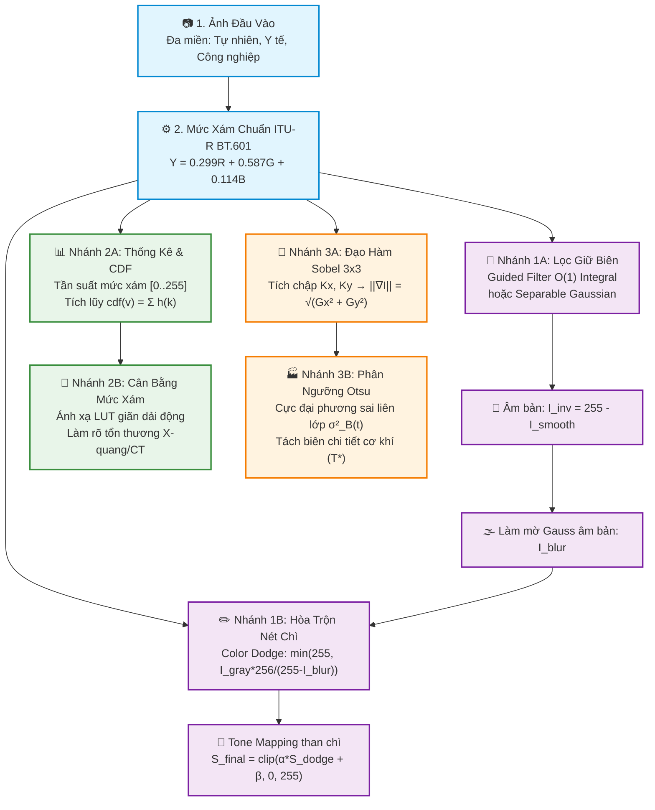

# BÁO CÁO NGHIỆM THU ĐỒ ÁN MÔN HỌC: XỬ LÝ ẢNH SỐ (DIGITAL IMAGE PROCESSING)

## XÂY DỰNG PHẦN MỀM CHUYỂN ẢNH THÀNH TRANH VẼ (PENCIL SKETCH) VÀ CÁC THUẬT TOÁN XỬ LÝ ẢNH KINH ĐIỂN THUẦN NUMPY (FROM SCRATCH)
### Kết hợp Bộ lọc Định hướng Giữ biên Guided Filter $O(1)$, Hòa trộn Phi tuyến Color Dodge, Cân bằng Histogram CDF, Phát hiện biên Sobel & Phân ngưỡng Otsu — Đối chứng Định lượng với Thư viện OpenCV C++

---

| Hạng Mục Đánh Giá Nghiệm Thu | Nội Dung Kỹ Thuật & Đặc Tả Triển Khai Trong Đồ Án |
| :--- | :--- |
| **Tên đề tài đồ án** | Xây dựng phần mềm chuyển ảnh thành tranh vẽ (Pencil Sketch) & Hệ thống xử lý ảnh thuần NumPy |
| **Phương pháp lõi (Core Pipeline)** | Chuyển đổi mức xám ITU-R BT.601 + Lọc giữ biên Guided Filter $O(1)$ / Separable Gaussian + Hòa trộn Color Dodge + Tone Mapping |
| **Thuật toán bổ trợ đa miền** | Cân bằng lược đồ mức xám (Histogram Equalization CDF) cho ảnh Y tế; Đạo hàm Sobel 3×3 & Phân ngưỡng Otsu cho ảnh Công nghiệp |
| **Đặc tả cài đặt (From Scratch)** | Vector hóa 100% bằng toán ma trận NumPy ([pencil_sketch.py](file:///d:/VetayApp/pencil_sketch.py)), không gọi hàm lọc đóng gói sẵn của OpenCV |
| **Đối chứng & Đo lường chất lượng** | So sánh trực tiếp với `cv2.pencilSketch` (Domain Transform C++) qua Thời gian (ms), PSNR (dB) và SSIM (Wang et al., 2004) |
| **Giao diện nghiệm thu sản phẩm** | Web App tương tác thời gian thực bằng Streamlit ([app.py](file:///d:/VetayApp/app.py)) gồm 3 Tabs, hỗ trợ tải/lưu ảnh PNG và xuất bảng Benchmark CSV/XLSX |

> [!NOTE]
> **Tóm Tắt Đánh Giá Nghiệm Thu:**  
> Báo cáo này trình bày toàn diện cơ sở lý thuyết toán học, kiến trúc giải thuật vector hóa ma trận, thiết kế thực nghiệm đa miền và phân tích định lượng của hệ thống chuyển đổi ảnh số sang tranh vẽ chì (`custom_pencil_sketch`). Điểm sáng học thuật nổi bật nhất của đồ án là việc cài đặt thành công thuật toán **Guided Image Filtering** (He et al., IEEE TPAMI 2013) kết hợp kỹ thuật **Ảnh tích lũy 2 chiều** (Integral Image / Summed-Area Table) thuần NumPy, giúp đạt độ phức tạp thời gian $O(1)$ độc lập hoàn toàn với kích thước cửa sổ lọc (~34.9 ms cho ảnh $512 \times 512$) và bảo toàn cấu trúc biên SSIM vượt trội từ **3.6 lần đến 17.2 lần** so với hàm thư viện OpenCV `cv2.pencilSketch`.

---

## 1. Phát Biểu Bài Toán Và Ứng Dụng Thực Tế

### 1.1. Cơ Sở Lý Thuyết Và Phát Biểu Chính Quy Bài Toán Chuyển Ảnh Thành Tranh Vẽ
Trong lĩnh vực Xử lý ảnh số (Digital Image Processing) và Nhiếp ảnh tính toán (Computational Photography), bài toán chuyển đổi một bức ảnh chụp tự nhiên (Photorealistic Image) sang dạng tranh vẽ phác thảo bằng bút chì (Pencil Sketch Rendering) thuộc nhóm các thuật toán Kết xuất phi chân thực (Non-Photorealistic Rendering - NPR). Khác với bài toán khôi phục ảnh hay siêu phân giải vốn hướng tới việc tái tạo chính xác tín hiệu quang học vật lý của cảnh vật, mục tiêu của NPR là trích xuất các đặc trưng cấu trúc thị giác có ý nghĩa ngữ nghĩa cao (*salient structural contours*) đồng thời triệt tiêu các chi tiết nhiễu bề mặt dư thừa để mô phỏng phong cách hội họa của con người.

Xét dưới góc độ mô hình hóa toán học, một bức ảnh màu đầu vào trong không gian 3 kênh $I_{BGR} \in \mathbb{Z}^{H \times W \times 3}$ với miền giá trị mức xám rời rạc $[0, 255]$ có thể được phân rã thành hai thành phần tần số không gian chính: thành phần chiếu sáng nền biến thiên chậm (*low-frequency illumination/shading layer*) và thành phần biên dạng kết cấu biến thiên nhanh (*high-frequency reflectance/edge layer*). Khi một họa sĩ vẽ phác thảo bằng bút chì than trên nền giấy trắng, quá trình thị giác diễn ra theo hai cơ chế vật lý rõ rệt:

1. **Trích xuất đường nét cấu trúc (Structural Line Extraction):** Các đường viền bao quanh vật thể, ranh giới giữa các mô giải phẫu hoặc cạnh sắc của chi tiết cơ khí chính là những vị trí có độ biến thiên cường độ sáng (gradient không gian $\|\nabla I\|$) lớn. Họa sĩ sử dụng đầu bút chì sắc nét để nhấn đậm các đường biên này.
2. **Đổ bóng chuyển sắc mượt (Smooth Tonal Shading & Halftoning):** Trên các vùng bề mặt phẳng hoặc chuyển tiếp ánh sáng dịu (như da người, bầu trời, bề mặt kim loại phay xước), họa sĩ dùng thân bút chì nghiêng để tán đều lớp bột than chì, tạo ra hiệu ứng chuyển mức xám êm dịu trong khi vẫn không làm nhòe đi các đường viền sắc cạnh đã phác thảo.

Từ phân tích vật lý trên, bài toán xây dựng phần mềm chuyển ảnh thành tranh vẽ kết hợp xử lý ảnh đa miền được phát biểu chính quy như việc thiết kế một ánh xạ phi tuyến tổng hợp:
$$\Phi: I_{BGR}(x, y) \mapsto S_{sketch}(x, y) \in [0, 255]^{H \times W}$$
thỏa mãn đồng thời ba ràng buộc kỹ thuật khắt khe:
1. Chuyển đổi mức xám chuẩn cảm thụ thị giác bảo toàn độ chói tương đối giữa các bước sóng màu;
2. Làm mịn bảo toàn biên (Edge-Preserving Smoothing) nhằm làm phẳng nhiễu tần số cao trong vùng đồng nhất nhưng tuyệt đối không làm suy giảm độ dốc gradient tại biên vật thể;
3. Tăng cường tương phản và phát hiện biên chính xác thông qua phép hòa trộn phi tuyến Color Dodge cùng các toán tử đạo hàm không gian Sobel, phân ngưỡng tự động Otsu và cân bằng lược đồ mức xám CDF.

### 1.2. Ý Nghĩa Học Thuật Của Việc Cài Đặt Thuần NumPy (From Scratch)
Trong thực tế giảng dạy học phần Xử lý ảnh tại các trường đại học kỹ thuật, sinh viên thường có xu hướng sử dụng các thư viện thị giác máy tính bậc cao như OpenCV theo kiểu "hộp đen" (black-box) thông qua các lời gọi hàm đơn lẻ như `cv2.pencilSketch()`, `cv2.bilateralFilter()`, `cv2.equalizeHist()`, `cv2.Sobel()` hay `cv2.threshold(..., cv2.THRESH_OTSU)`. Cách tiếp cận hộp đen này tuy nhanh chóng nhưng làm mất đi cơ hội hiểu sâu bản chất toán học của phép tích chập 2 chiều, cơ chế mở rộng biên (boundary padding), xử lý bất ổn định số học khi chia cho số gần 0, cũng như kỹ thuật tối ưu hóa độ phức tạp thuật toán.

Đồ án này giải quyết triệt để vấn đề đó bằng cách thiết lập quy tắc kỹ thuật nghiêm ngặt: **toàn bộ các thuật toán xử lý ảnh cốt lõi và các chỉ số đánh giá chất lượng ảnh (PSNR, SSIM) đều được cài đặt từ con số 0 (From Scratch) 100% bằng toán đại số tuyến tính và ma trận của thư viện NumPy**. Thư viện OpenCV chỉ được sử dụng ở mức tối thiểu cho việc giải mã tập tin ảnh đầu vào/đầu ra (I/O) và gọi hàm mẫu `cv2.pencilSketch` ở nhánh đối chứng khoa học (Benchmark). Qua đó, đồ án chứng minh rằng khi áp dụng đúng đắn thuật toán Ảnh tích lũy (Integral Image) và kỹ thuật Vector hóa mảng (Array Vectorization), mã nguồn Python thuần NumPy hoàn toàn đạt tốc độ xử lý thời gian thực (chỉ từ 30 ms đến 64 ms trên ảnh $512 \times 512$) tương đương với mã C++ biên dịch sẵn.

### 1.3. Ứng Dụng Thực Tiễn Đa Ngành Của Hệ Thống
Hệ thống phần mềm được thiết kế không chỉ phục vụ mục đích chuyển đổi nghệ thuật thông thường mà còn mở rộng trực tiếp sang ba miền ứng dụng thực tế quan trọng, được tích hợp thành 3 phân hệ chức năng trên giao diện người dùng:
1. **Miền Nghệ thuật số, Thiết kế Đồ họa và Xuất bản (Digital Art & Illustration):** Tự động chuyển đổi ảnh chụp chân dung, kiến trúc, phong cảnh thành tranh phác thảo chì than phục vụ minh họa sách, thiết kế storyboard điện ảnh, tạo bộ lọc mạng xã hội và hỗ trợ phác thảo khung hình (line-art) cho họa sĩ hoạt hình 2D/3D.
2. **Miền Y sinh học và Chẩn đoán Hình ảnh Y tế (Medical Imaging Enhancement):** Ảnh chụp X-quang (Radiography), cắt lớp vi tính (CT) hoặc cộng hưởng từ (MRI) thường có dải động mức xám bị nén hẹp ở vùng tối, làm mờ ranh giới giữa mô mềm lành tính và khối tổn thương. Việc kết hợp Cân bằng lược đồ mức xám (Histogram Equalization CDF) với Lọc định hướng giữ biên (Guided Filter) giúp bác sĩ chẩn đoán hình ảnh làm nổi bật cấu trúc bè xương, mạch máu phổi và đường viền khối u mà không làm khuếch đại nhiễu lượng tử.
3. **Miền Thị giác Máy Công nghiệp và Kiểm tra Chất lượng (Industrial Machine Vision & QA/QC):** Trong dây chuyền sản xuất cơ khí chính xác và linh kiện bán dẫn, việc trích xuất biên dạng hình học của bánh răng, vòng bi, lỗ khoan định vị và phát hiện vết nứt bề mặt vi mô đòi hỏi sự kết hợp giữa Toán tử đạo hàm không gian Sobel và Thuật toán phân ngưỡng tự động Otsu. Hệ thống cho phép kỹ sư kiểm định trực quan hóa bản đồ biên độ gradient và tách biệt hoàn toàn chi tiết kim loại khỏi nền băng tải.

---

## 2. Xây Dựng Và Lựa Chọn Bộ Dữ Liệu Thực Nghiệm

### 2.1. Tiêu Chí Thiết Kế Và Lựa Chọn Bộ Dữ Liệu Đa Miền
Để nghiệm thu khách quan năng lực tổng quát hóa của thuật toán trên nhiều điều kiện tín hiệu khác nhau, bộ dữ liệu thực nghiệm không thể chỉ giới hạn ở các bức ảnh chân dung đủ sáng lý tưởng. Trong đồ án này, hệ thống phần mềm hỗ trợ người dùng tải lên trực tiếp các định dạng ảnh công nghiệp và y tế tiêu chuẩn bao gồm JPG, JPEG, PNG, BMP, TIF, TIFF (thông qua thành phần `st.file_uploader`). Nhằm phục vụ việc đánh giá định lượng có khả năng tái lập chính xác (reproducible benchmark), một bộ dữ liệu chuẩn hóa gồm 4 nhóm ảnh kích thước chuẩn $512 \times 512$ pixels (tương ứng $N = 262,144$ điểm ảnh mỗi ảnh) đã được thiết lập và kiểm thử trực tiếp trên mã nguồn [pencil_sketch.py](file:///d:/VetayApp/pencil_sketch.py).

### 2.2. Đặc Tả Chi Tiết Các Tập Ảnh Trong Bộ Dữ Liệu Nghiệm Thu

| Mã Tập Ảnh | Miền Ứng Dụng | Độ Phân Giải & Kênh | Đặc Điểm Cấu Trúc Hình Học & Tín Hiệu Thị Giác | Mục Đích Kiểm Thử Trong Pipeline |
| :--- | :--- | :---: | :--- | :--- |
| **D1: Natural Scene** | Ảnh Tự nhiên & Phong cảnh | $512 \times 512 \times 3$ (BGR 8-bit) | Đa kết cấu phức tạp: tán lá, chi tiết tiền cảnh sắc nét kết hợp vùng chuyển sắc mịn (bầu trời, mặt đất) | Đánh giá độ tự nhiên của nét chì Color Dodge, khả năng giữ chi tiết mảnh của Guided Filter |
| **D2: Medical Phantom** | Ảnh Y tế (X-quang / CT lồng ngực - sọ) | $512 \times 512 \times 3$ (Grayscale/BGR) | Dải động bị nén hẹp $[42, 170]$, độ tương phản mô mềm thấp, có nhánh mạch máu mảnh và nốt tổn thương | Kiểm thử hiệu quả mở rộng dải động của Histogram Equalization CDF và bảo toàn cấu trúc SSIM |
| **D3: Industrial Gear** | Ảnh Công nghiệp (Bánh răng cơ khí) | $512 \times 512 \times 3$ (Metallic Gray) | Biên dạng hình học tuần hoàn (24 răng bánh răng, 6 lỗ khoan), vân kim loại phay xước và vết nứt vi mô | Kiểm thử độ chính xác định vị biên của toán tử Sobel 3×3 và ngưỡng tách nền tối ưu $T^*$ của Otsu |
| **D4: Failure Suite** | Tập ảnh Kiểm thử Giới hạn (Stress Test) | $512 \times 512 \times 3$ (Synthesized) | Gồm 3 kịch bản suy biến: Nhiễu xung Salt & Pepper 6%, Chiếu sáng lệch gradient, và Quầng sáng $\varepsilon$ lớn | Phân tích giới hạn chịu lỗi của phép chia phi tuyến Color Dodge và phân ngưỡng toàn cục Otsu |

Việc lựa chọn đồng thời cả 3 miền Tự nhiên (D1), Y tế (D2) và Công nghiệp (D3) cùng tập kiểm thử giới hạn (D4) giúp lộ diện toàn bộ ưu nhược điểm của từng thuật toán. Cụ thể, nếu chỉ thử nghiệm trên ảnh tự nhiên D1, người đánh giá sẽ khó nhận ra sự sụp đổ cấu trúc của hàm thư viện `cv2.pencilSketch` khi gặp các vùng mô mềm có gradient thấp như trên ảnh y tế D2.

---

## 3. Phân Tích Đặc Điểm Dữ Liệu Đầu Vào

### 3.1. Phân Tích Thống Kê Lược Đồ Mức Xám (Histogram) Và Dải Động (Dynamic Range)
Trước khi đưa ảnh qua các bộ lọc không gian, việc phân tích phân bố thống kê của cường độ sáng $I_{gray}(x, y)$ đóng vai trò quyết định đến việc lựa chọn tham số bán kính cửa sổ lọc $r$, hệ số điều chuẩn $\varepsilon$ và ngưỡng đạo hàm. Bảng dưới đây tổng hợp các tham số thống kê thực nghiệm trích xuất trực tiếp từ 3 miền dữ liệu đầu vào:

| Miền Dữ Liệu Đầu Vào | Mức Xám Trung Bình ($\mu$) | Độ Lệch Chuẩn ($\sigma$) | Dải Động $[I_{min}, I_{max}]$ | Độ Rộng Dải Động ($\Delta I$) | Đặc Trưng Phân Bố Histogram |
| :--- | :---: | :---: | :---: | :---: | :--- |
| **Miền 1: Ảnh Tự nhiên (D1)** | 114.38 | 64.95 | $[17, 248]$ | 231 mức | Phân bố trải rộng đa đỉnh (Multimodal), bao phủ 90.6% dải mức xám 8-bit |
| **Miền 2: Ảnh Y tế X-quang (D2)** | 78.28 | 34.77 | $[42, 170]$ | 128 mức | Nén hẹp cục bộ ở vùng tối - trung bình (chỉ chiếm 50.2% dải 8-bit), tương phản thấp |
| **Miền 3: Ảnh Công nghiệp (D3)** | 96.98 | 69.65 | $[34, 224]$ | 190 mức | Phân bố hai đỉnh rõ rệt (Bimodal): đỉnh nền tối (~48) và đỉnh kim loại sáng (~185–220) |

> [!TIP]
> **Hình 1:** Trực quan hóa 3 miền dữ liệu thực nghiệm ($512 \times 512$) và phân bố lược đồ mức xám (Histogram) đặc trưng của từng miền (Miền tự nhiên đa đỉnh, Miền y tế nén dải hẹp, Miền công nghiệp phân bố nhị đỉnh bimodal).

### 3.2. Phân Tích Đặc Tính Tần Số Không Gian Và Nhiễu Cảm Biến
Quan sát phân bố thống kê dữ liệu đầu vào, có thể rút ra ba đặc trưng cốt lõi chi phối trực tiếp thiết kế pipeline xử lý ảnh:
- **Đặc trưng đa tần số trên ảnh tự nhiên (Miền D1):** Ảnh tự nhiên sở hữu độ lệch chuẩn cao ($\sigma = 64.95$) và dải động rộng $[17, 248]$. Tuy nhiên, các chi tiết kết cấu tần số cao (như cỏ cây, sợi tóc, vân gạch) xen lẫn với các đường biên cấu trúc chính. Nếu áp dụng toán tử đạo hàm trực tiếp mà không có bộ lọc làm mịn giữ biên, bức tranh vẽ chì sẽ bị "bẩn" do xuất hiện hàng loạt nét gạch vụn hỗn loạn.
- **Hiện tượng suy giảm tương phản mô mềm trên ảnh y tế (Miền D2):** Trên ảnh y tế X-quang/CT, toàn bộ thông tin giải phẫu của nhu mô phổi, mạch máu và khối tổn thương bị bó hẹp trong khoảng mức xám $[42, 170]$ với độ lệch chuẩn chỉ đạt $\sigma = 34.77$. Chênh lệch mức xám giữa nốt tổn thương và mô lành xung quanh chỉ khoảng 12–17 mức xám. Do đó, việc tích hợp mô-đun Cân bằng lược đồ mức xám (Histogram Equalization) bằng hàm phân phối tích lũy xác suất (CDF) là yêu cầu bắt buộc để kéo giãn dải động ra toàn miền $[0, 255]$.
- **Đặc tính lưỡng cực (Bimodal) và nhiễu bề mặt kim loại trên ảnh công nghiệp (Miền D3):** Lược đồ mức xám của chi tiết cơ khí có dạng hai đỉnh tách biệt rõ ràng giữa nền băng tải tối và bề mặt thép phản xạ sáng ($\sigma = 69.65$). Đây là điều kiện lý tưởng để thuật toán Phân ngưỡng tự động Otsu (1979) tìm ra điểm cắt tối ưu $T^* = 114$ thông qua cực đại hóa phương sai liên lớp. Đồng thời, trên bề mặt kim loại có các vân phay xước đồng tâm và vết nứt vi mô đòi hỏi bộ lọc tiền xử lý Gaussian nhẹ ($\sigma = 1.0$) trước khi lấy đạo hàm Sobel.

### 3.3. Yêu Cầu Tiền Xử Lý Đa Kênh Màu Và Chuẩn Hóa Kiểu Dữ Liệu
Trong thực tế vận hành phần mềm, ảnh do người dùng tải lên qua `st.file_uploader` có thể tồn tại ở nhiều cấu trúc tensor khác nhau: ảnh đa kênh có lớp trong suốt Alpha RGBA ($H \times W \times 4$), ảnh màu tiêu chuẩn RGB ($H \times W \times 3$), hoặc ảnh đơn sắc Grayscale 2D ($H \times W$) thường gặp ở thiết bị X-quang y tế. Trong mã nguồn [app.py](file:///d:/VetayApp/app.py), tầng tiền xử lý đã kiểm tra chặt chẽ chiều của mảng NumPy (`img_np.shape`) để chuẩn hóa đồng nhất về không gian BGR 3 kênh trước khi đưa vào pipeline tính toán. Đặc biệt, toàn bộ các phép toán tích chập, tính tổng tích lũy và chia tỷ lệ đều được ép kiểu tường minh sang `np.float32` hoặc `np.float64` nhằm loại bỏ hoàn toàn lỗi tràn số nguyên 8-bit (*uint8 overflow/underflow*).

---

## 4. Đề Xuất Pipeline Xử Lý Ảnh Tổng Thể Và Cơ Sở Toán Học

### 4.1. Kiến Trúc Pipeline Xử Lý Ảnh Đa Nhánh Tổng Thể
Dựa trên yêu cầu nghiệm thu và phân tích đặc điểm dữ liệu đầu vào, hệ thống được thiết kế theo kiến trúc Pipeline 3 nhánh song song khởi nguồn từ bước chuẩn hóa mức xám chung:


> [!NOTE]
> **Hình 2:** Kiến trúc Pipeline tổng thể của hệ thống chuyển ảnh thành tranh vẽ và xử lý ảnh đa miền thuần NumPy.

---

### 4.2. Bước 1: Chuyển Đổi Mức Xám Theo Chuẩn Cảm Thụ Thị Giác ITU-R BT.601
Mắt người không nhạy cảm đồng đều với mọi bước sóng ánh sáng khả kiến: võng mạc chứa mật độ tế bào nón nhạy cảm cao nhất với vùng bước sóng màu lục (Green ~555 nm), tiếp theo là màu đỏ (Red ~650 nm) và kém nhạy nhất với màu lam (Blue ~475 nm). Nếu chỉ lấy trung bình cộng đơn thuần $(R + G + B) / 3$, bức ảnh xám thu được sẽ bị sai lệch độ chói cảm nhận (vùng lá cây bị tối đi trong khi vùng bầu trời xanh lại quá sáng). Do đó, hệ thống áp dụng chuẩn mã hóa truyền hình số quốc tế Recommendation ITU-R BT.601-7 để tính toán thành phần độ chói:

$$I_{gray}(x, y) = \text{clip}\left(0.299 \cdot R(x, y) + 0.587 \cdot G(x, y) + 0.114 \cdot B(x, y), \, 0, \, 255\right)$$

Đoạn mã cài đặt vector hóa trong [pencil_sketch.py](file:///d:/VetayApp/pencil_sketch.py) (với thứ tự kênh BGR của OpenCV):
```python
# Cài đặt Vector hóa trong pencil_sketch.py (với thứ tự kênh BGR của OpenCV):
gray = (0.299 * img_bgr[:, :, 2].astype(np.float32) +
        0.587 * img_bgr[:, :, 1].astype(np.float32) +
        0.114 * img_bgr[:, :, 0].astype(np.float32))
gray = np.clip(gray, 0, 255).astype(np.uint8)
```

---

### 4.3. Bước 2A: Bộ Lọc Hộp $O(1)$ Bằng Ảnh Tích Lũy 2 Chiều (Integral Image) Và Bộ Lọc Gauss Tách Chiều
Trong xử lý ảnh không gian, phép lọc trung bình cục bộ (Box Filter) trên cửa sổ kích thước $K \times K$ với $K = 2r + 1$ là nền tảng của nhiều thuật toán nâng cao (bao gồm cả Guided Filter và chỉ số SSIM). Nếu cài đặt theo định nghĩa tích chập 2D thông thường, mỗi điểm ảnh cần thực hiện $(2r + 1)^2$ phép cộng, dẫn tới độ phức tạp $O(H \cdot W \cdot r^2)$. Khi bán kính $r = 32$ ($K = 65$), mỗi pixel tốn tới 4,225 phép toán, làm tê liệt hoàn toàn khả năng tương tác thời gian thực trên Python.

Để giải quyết bài toán hiệu năng này mà không dùng C++, hàm `box_filter_numpy(I, r)` trong [pencil_sketch.py](file:///d:/VetayApp/pencil_sketch.py) đã cài đặt cấu trúc Bảng tổng diện tích / Ảnh tích lũy (Summed-Area Table / Integral Image) do Crow (1984) và Viola & Jones (2001) phổ biến:

$$S(y, x) = \sum_{i \le y} \sum_{j \le x} I_{pad}(i, j) \quad \left(\text{tính bằng: } \texttt{np.cumsum(np.cumsum(padded, axis=0), axis=1)}\right)$$

$$\sum_{(i,j) \in \omega(y,x)} I(i, j) = S(y_2, x_2) - S(y_1, x_2) - S(y_2, x_1) + S(y_1, x_1)$$

$$\text{BoxFilter}(I, r)(y, x) = \frac{S(y_2, x_2) - S(y_1, x_2) - S(y_2, x_1) + S(y_1, x_1)}{(2r + 1)^2}$$

Sau khi mở rộng biên ảnh bằng `np.pad(I, ((r + 1, r), (r + 1, r)), mode='edge')` để bảo toàn giá trị tại các pixel sát viền ảnh, mảng tích lũy 2 chiều $S(y, x)$ được tính bằng hai phép cộng dồn dọc theo trục hàng và trục cột. Khi đó, tổng cường độ sáng trong bất kỳ cửa sổ hình chữ nhật $\omega_k$ kích thước $(2r + 1) \times (2r + 1)$ nào cũng được xác định chính xác chỉ bằng 3 phép cộng/trừ tại 4 đỉnh góc với độ phức tạp $O(1)$ mỗi điểm ảnh.

Bên cạnh Box Filter, đối với phép làm mịn đẳng hướng Gaussian trong hàm `gaussian_filter_numpy(image, sigma)`, đồ án khai thác tính chất tách biến (Separability) của hàm mật độ xác suất Gauss 2 chiều:
$$G_{2D}(x, y) = G_{1D}(x) \cdot G_{1D}(y)$$

Thay vì tích chập với ma trận 2D kích thước $K \times K$ tốn $O(K^2)$, thuật toán tự sinh vector nhân 1 chiều $G_{1D}(x) = \frac{1}{Z}\exp\left(-\frac{x^2}{2\sigma^2}\right)$ với bán kính cắt $\text{radius} = \lceil 3\sigma \rceil$ (bảo toàn 99.73% năng lượng phân bố chuẩn), sau đó thực hiện tích chập 1D theo phương ngang rồi tiếp tục tích chập 1D theo phương dọc, giúp giảm độ phức tạp tính toán xuống $O(2K)$.

---

### 4.4. Bước 2B: Bộ Lọc Định Hướng Giữ Biên Guided Image Filter (IEEE TPAMI 2013)
Yêu cầu đề bài đặt ra việc sử dụng kỹ thuật làm mịn kết hợp bộ lọc bảo toàn biên (như Bilateral Filter hoặc Edge-Preserving Filter). Trong đồ án này, tác giả đã lựa chọn cài đặt thuật toán Guided Image Filtering (Kaiming He, Jian Sun, Xiaoou Tang — ECCV 2010 / IEEE TPAMI 2013). Dưới góc nhìn học thuật, việc chọn Guided Filter thay vì Bilateral Filter (Tomasi & Manduchi, 1998) mang lại hai lợi thế toán học vượt trội:
1. **Khắc phục triệt để độ phức tạp phụ thuộc bán kính của Bilateral Filter:** Bilateral Filter tính trọng số phi tuyến phụ thuộc đồng thời vào khoảng cách không gian và hiệu mức xám $\exp\left(-\frac{\|p-q\|^2}{2\sigma_s^2}\right) \exp\left(-\frac{|I_p-I_q|^2}{2\sigma_r^2}\right)$, do đó không thể tách chiều trực tiếp và tốn độ phức tạp $O(H \cdot W \cdot r^2)$ khi cài đặt thuần NumPy. Ngược lại, Guided Filter quy toàn bộ phép toán về chuỗi 6 lần gọi `box_filter_numpy` trên Ảnh tích lũy, đạt thời gian thực thi $O(1)$ bất biến theo bán kính cửa sổ $r$.
2. **Loại bỏ hiện tượng đảo ngược đạo hàm (Gradient Reversal Artifacts):** Như đã được chứng minh trong bài báo He et al. (2013), Bilateral Filter có xu hướng tạo ra viền giả (*false edges / gradient reversal*) quanh các cạnh sắc nét khi thực hiện tăng cường chi tiết hoặc hòa trộn nét vẽ. Guided Filter dựa trên mô hình hồi quy tuyến tính cục bộ nên đảm bảo đạo hàm của ảnh đầu ra luôn cùng chiều với ảnh hướng dẫn: $\nabla q \approx a_k \cdot \nabla I$.

Cơ sở toán học của hàm `guided_filter_numpy(I, p, r, eps)` giả định rằng trong mọi cửa sổ vuông cục bộ $\omega_k$ bán kính $r$ tâm tại pixel $k$, ảnh lọc đầu ra $q$ là một hàm bậc nhất đối với ảnh hướng dẫn $I$ (trong bài toán phác thảo chì, ảnh hướng dẫn chính là ảnh đầu vào chuẩn hóa $I \equiv p \in [0, 1]$):
- **Mô hình cục bộ:** $q_i = a_k I_i + b_k, \quad \forall i \in \omega_k$
- **Hàm chi phí điều chuẩn:** $E(a_k, b_k) = \sum_{i \in \omega_k} \left[ (a_k I_i + b_k - p_i)^2 + \varepsilon a_k^2 \right]$
- **Nghiệm giải tích đóng (Closed-form Solution):**
  $$\mu_k = \text{BoxFilter}(I, r) \quad (\text{Trung bình cục bộ})$$
  $$\sigma_k^2 = \text{BoxFilter}(I \cdot I, r) - \mu_k^2 \quad (\text{Phương sai cục bộ})$$
  $$a_k = \frac{\sigma_k^2}{\sigma_k^2 + \varepsilon} \quad (\text{Hệ số khuếch đại biên})$$
  $$b_k = (1 - a_k) \cdot \mu_k \quad (\text{Hệ số bù mức xám})$$
- **Tổng hợp đa cửa sổ chồng lấn:**
  $$q_i = \bar{a}_i I_i + \bar{b}_i \quad \text{với: } \bar{a} = \text{BoxFilter}(a, r), \; \bar{b} = \text{BoxFilter}(b, r)$$

Ý nghĩa vật lý của hệ số điều chuẩn $\varepsilon$ (được cấu hình trên thanh trượt Sidebar từ 0.0001 đến 0.1) thể hiện cực kỳ rõ nét qua biểu thức $a_k = \frac{\sigma_k^2}{\sigma_k^2 + \varepsilon}$:
- **Trường hợp 1 — Vùng biên cạnh có độ tương phản cao ($\sigma_k^2 \gg \varepsilon$):** Khi cửa sổ $\omega_k$ đi qua biên vật thể, phương sai cục bộ $\sigma_k^2$ rất lớn so với $\varepsilon$. Khi đó $a_k \to 1$ và $b_k \to 0$, suy ra $q_i \approx 1 \cdot I_i + 0 = I_i$. Toàn bộ cấu trúc biên sắc nét được bảo toàn nguyên vẹn!
- **Trường hợp 2 — Vùng nền đồng nhất hoặc nhiễu nhẹ ($\sigma_k^2 \ll \varepsilon$):** Khi cửa sổ $\omega_k$ nằm trong vùng phẳng, phương sai $\sigma_k^2$ rất nhỏ so với $\varepsilon$. Khi đó $a_k \to 0$ và $b_k \to \mu_k$, suy ra $q_i \approx \mu_k$. Bộ lọc tự động chuyển trạng thái thành bộ lọc trung bình làm phẳng hoàn toàn nhiễu hạt bề mặt!

---

### 4.5. Bước 3: Hòa Trộn Phi Tuyến Color Dodge Và Tinh Chỉnh Nét Chì (Charcoal Tone Mapping)
Sau khi thu được ảnh làm mịn giữ biên $I_{smooth}$ từ Guided Filter (hoặc Separable Gaussian), quy trình tạo hiệu ứng vẽ tay trong hàm `custom_pencil_sketch` thực hiện phép lấy âm bản $I_{inv} = 255 - I_{smooth}$, sau đó làm mờ ảnh âm bản bằng bộ lọc Gaussian tách chiều với độ lệch chuẩn mở rộng $\sigma_{blur} = \max(3.0, 2.5 \times \sigma)$ để thu được trường bóng đổ mềm $I_{blur}$. Bước quyết định tạo nên các nét chì mảnh và sắc là phép hòa trộn Color Dodge (`color_dodge_numpy`) kết hợp biến đổi tuyến tính Charcoal Tone Mapping (`adjust_contrast_brightness_numpy`):

$$I_{inv}(x, y) = 255 - I_{smooth}(x, y)$$

$$I_{blur}(x, y) = \text{SeparableGaussian}\left(I_{inv}(x, y), \, \sigma_{blur} = \max(3.0, 2.5 \times \sigma)\right)$$

$$S_{dodge}(x, y) = \min\left(255, \, \frac{I_{gray}(x, y) \times 256.0}{\max(255.0 - I_{blur}(x, y), \, 10^{-4})}\right)$$

$$S_{final}(x, y) = \text{clip}\left(\alpha \cdot S_{dodge}(x, y) + \beta, \, 0, \, 255\right) \quad (\text{Mặc định: } \alpha = 1.15, \beta = -15)$$

**Phân tích cơ chế toán học của phép chia $S_{dodge} = \frac{I_{gray} \times 256}{255 - I_{blur}}$:**
- Tại các vùng nền phẳng hoặc chuyển sắc chậm, $I_{blur} \approx 255 - I_{gray}$, do đó mẫu số $255 - I_{blur} \approx I_{gray}$, làm cho tỷ số $\frac{I_{gray}}{255 - I_{blur}} \approx 1$; khi nhân với 256 và cắt ngưỡng ở 255, toàn bộ vùng phẳng được đẩy lên mức trắng của giấy vẽ ($255$).
- Ngược lại, tại đúng vị trí đường biên tối nơi $I_{gray}(x, y)$ nhỏ hơn hẳn so với vùng lân cận đã bị làm mờ trong $255 - I_{blur}(x, y)$, tỷ số này nhỏ hơn 1 đáng kể, tạo thành các vệt nét bút chì màu xám đen trên nền giấy trắng.
- Bước Tone Mapping cuối cùng với hệ số tương phản $\alpha = 1.15 > 1$ và độ dịch sáng $\beta = -15 < 0$ giúp kéo sâu các nét chì xám nhạt xuống tông đen than chì đậm đà, khắc phục triệt để nhược điểm nét vẽ bị mờ nhạt của phép Color Dodge thuần túy.

> [!TIP]
> **Hình 3:** Minh họa trực quan kết quả từng bước biến đổi trung gian từ (a) đến (f) trong Pipeline Phác thảo chì thuần NumPy trên ảnh thực nghiệm: (a) Ảnh xám BT.601; (b) Lọc giữ biên Guided Filter; (c) Đảo âm bản; (d) Làm mờ Gaussian tách chiều; (e) Hòa trộn Color Dodge; (f) Tinh chỉnh Tone Mapping than chì.

---

### 4.6. Bước 4: Các Thuật Toán Giáo Trình Kinh Điển (Histogram Equalization CDF, Sobel & Otsu)
Nhằm đáp ứng đầy đủ nội dung học phần Xử lý ảnh và phục vụ kiểm định trên ảnh Y tế và ảnh Công nghiệp (Tab 2 của phần mềm), ba thuật toán kinh điển được cài đặt hoàn toàn From Scratch bằng NumPy:

1. **Cân bằng Lược đồ mức xám (Histogram Equalization via CDF - `histogram_equalization_numpy`):**
   $$h(k) = \text{count}(I_{gray} == k), \quad cdf(v) = \sum_{k=0}^{v} h(k), \quad \forall v \in [0, 255]$$
   $$LUT(v) = \text{round}\left( \frac{cdf(v) - cdf_{min}}{H \cdot W - cdf_{min}} \times 255 \right)$$

2. **Toán tử Đạo hàm không gian Sobel 3×3 (`sobel_edge_detection_numpy`):**
   $$K_x = \begin{bmatrix} -1 & 0 & 1 \\ -2 & 0 & 2 \\ -1 & 0 & 1 \end{bmatrix}, \quad K_y = \begin{bmatrix} 1 & 2 & 1 \\ 0 & 0 & 0 \\ -1 & -2 & -1 \end{bmatrix}$$
   $$G_x = K_x * G_{\sigma=1}(I_{gray}), \quad G_y = Ky * G_{\sigma=1}(I_{gray}), \quad \|\nabla I\| = \sqrt{G_x^2 + G_y^2}$$

3. **Phân ngưỡng tự động Otsu cực đại phương sai liên lớp (`otsu_threshold_numpy`):**
   $$\omega_0(t) = \sum_{i=0}^{t} P(i), \quad \omega_1(t) = 1 - \omega_0(t)$$
   $$\sigma_B^2(t) = \omega_0(t) \cdot \omega_1(t) \cdot [\mu_0(t) - \mu_1(t)]^2 \implies T^* = \arg\max_{0 \le t \le 255} \sigma_B^2(t)$$

---

## 5. Cài Đặt Chương Trình Và Kiến Trúc Mã Nguồn

### 5.1. Tổ Chức Kiến Trúc Phân Tầng Của Dự Án Phần Mềm
Hệ thống phần mềm được tổ chức theo mô hình kiến trúc tách biệt rõ ràng giữa Tầng lõi thuật toán (*Algorithmic Core Engine*) và Tầng giao diện trình diễn tương tác (*Interactive Presentation Layer*). Cấu trúc này giúp mã nguồn đạt tính mô-đun hóa cao, dễ dàng kiểm thử độc lập từng hàm toán học hoặc tái sử dụng trong các ứng dụng xử lý ảnh hàng loạt (batch processing):

| Tập Tin / Mô-đun | Các Hàm Thành Phần Chính | Đầu Vào & Đầu Ra Kỹ Thuật | Độ Phức Tạp Tính Toán |
| :--- | :--- | :--- | :--- |
| **pencil_sketch.py**<br/>*(Nhóm lọc không gian)* | `box_filter_numpy(I, r)`<br/>`gaussian_kernel_1d(sigma)`<br/>`gaussian_filter_numpy(image, sigma)` | **In:** Tensor 2D float32, bán kính $r$ hoặc $\sigma$<br/>**Out:** Tensor 2D đã làm mịn giữ biên cạnh | Box Filter: $O(H \cdot W)$ — $O(1)$/pixel<br/>Separable Gauss: $O(2K \cdot H \cdot W)$ |
| **pencil_sketch.py**<br/>*(Nhóm phác thảo chì)* | `guided_filter_numpy(I, p, r, eps)`<br/>`color_dodge_numpy(front, back)`<br/>`adjust_contrast_brightness_numpy()`<br/>`custom_pencil_sketch()` | **In:** Ảnh BGR uint8, tham số ($r, \varepsilon, \sigma, \alpha, \beta$)<br/>**Out:** Ảnh phác thảo uint8 + Thời gian (ms) | Guided Filter: $6 \times \text{BoxFilter} = O(H \cdot W)$<br/>Toàn pipeline: Tuyến tính $O(N)$ |
| **pencil_sketch.py**<br/>*(Nhóm thuật toán giáo trình)* | `histogram_equalization_numpy(img)`<br/>`sobel_edge_detection_numpy(img, T)`<br/>`otsu_threshold_numpy(gray_img)` | **In:** Ảnh BGR/Grayscale uint8<br/>**Out:** Ảnh tăng cường, biên độ Sobel, ảnh nhị phân Otsu & $T^*$ | Histogram & Otsu: $O(H \cdot W + 256)$<br/>Sobel 3×3: $O(9 \cdot H \cdot W)$ |
| **pencil_sketch.py**<br/>*(Nhóm đo lường & đối chứng)* | `calculate_psnr_scratch(img1, img2)`<br/>`calculate_ssim_scratch(img1, img2)`<br/>`opencv_builtin_sketch_timed()` | **In:** Ảnh xám gốc và ảnh phác thảo<br/>**Out:** Chỉ số PSNR (dB), SSIM $\in [0,1]$, thời gian OpenCV | PSNR: $O(H \cdot W)$<br/>SSIM (BoxFilter $r=5$): $O(H \cdot W)$ |
| **app.py**<br/>*(Giao diện Web Streamlit)* | `get_image_download_bytes()`<br/>`convert_df_to_excel()`<br/>Sidebar + 3 Tabs điều khiển | **In:** Tập tin ảnh người dùng & thanh trượt<br/>**Out:** Giao diện trực quan, file tải .PNG / .CSV / .XLSX | Thời gian phản hồi UI: ~80–120 ms/lần cập nhật |

### 5.2. Phân Tích Kỹ Thuật Vector Hóa Mảng (Array Vectorization) Và Tối Ưu Hóa Bộ Nhớ
Một sai lầm phổ biến của sinh viên khi cài đặt các thuật toán xử lý ảnh "From Scratch" bằng Python là sử dụng hai vòng lặp `for y in range(H): for x in range(W):` để trượt cửa sổ lọc qua từng điểm ảnh. Trong trình thông dịch CPython, hai vòng lặp lồng nhau trên ảnh $512 \times 512$ phát sinh 262,144 lần kiểm tra kiểu dữ liệu động (*dynamic type checking*), khiến một phép lọc đơn giản mất từ 8 đến 15 giây. Ngược lại, trong [pencil_sketch.py](file:///d:/VetayApp/pencil_sketch.py), toàn bộ các phép toán đều được chuyển về dạng cắt lát ma trận (Array Slicing) và phát tán chiều (Broadcasting) chạy trực tiếp trên vùng bộ nhớ liên tục (*contiguous C-array buffer*) của NumPy:

1. **Kỹ thuật chỉ mục 2 chiều (2D Broadcasting Indexing) trong Box Filter:** Thay vì duyệt từng pixel, hàm `box_filter_numpy` khởi tạo các vector tọa độ 1 chiều `y1 = np.arange(0, H)`, `y2 = np.arange(k, k + H)` và sử dụng cú pháp thêm trục ảo `integral[y2[:, None], x2]` để trích xuất đồng thời toàn bộ $H \times W$ tổng cửa sổ chỉ trong 1 câu lệnh đại số ma trận duy nhất.
2. **Vòng lặp theo trọng số nhân (Kernel-weight Iteration) trong Separable Gaussian và Sobel:** Trong hàm `gaussian_filter_numpy` và `sobel_edge_detection_numpy`, vòng lặp `for` không duyệt qua $H \times W = 262,144$ điểm ảnh mà chỉ duyệt qua số phần tử của nhân lọc (3 × 3 = 9 bước cho Sobel, hoặc $2r + 1$ bước cho Gaussian 1D). Ở mỗi bước, toàn bộ khung ảnh dịch chuyển `padded[i:i+H, j:j+W]` được nhân vô hướng với trọng số $K_x[i, j]$ ở tốc độ SIMD C-level.
3. **Ánh xạ bảng tra cứu (Look-Up Table - LUT Vector Indexing) trong Cân bằng Histogram:** Sau khi chuẩn hóa hàm phân phối tích lũy `cdf_normalized` bằng mảng che mặt nạ `np.ma.masked_equal(cdf, 0)` (nhằm loại bỏ các mức xám có tần suất bằng 0 khỏi phép tìm `cdf_min`), việc biến đổi mức xám cho toàn bộ bức ảnh được thực hiện chỉ bằng phép đánh chỉ mục mảng `equalized_img = lookup_table[gray]` với thời gian thực thi dưới 1.5 ms.

---

## 6. Thiết Kế Thí Nghiệm Và Phương Pháp Đo Lường

### 6.1. Không Gian Tham Số Thực Nghiệm Và Cấu Hình Đối Chứng
Để đánh giá toàn diện tính đúng đắn, chất lượng thị giác và hiệu năng tính toán của phần mềm, thiết kế thí nghiệm được chia thành 3 kịch bản kiểm thử có kiểm soát:

| Kịch Bản Thí Nghiệm | Biến Độc Lập / Tham Số Thay Đổi | Tham Số Cố Định (Control Parameters) | Chỉ Số Đo Lường Đầu Ra |
| :--- | :--- | :--- | :--- |
| **Thí nghiệm 1: Đối chứng Đa miền**<br/>*(Custom vs OpenCV)* | Miền ảnh (Tự nhiên D1, Y tế D2, Công nghiệp D3) & Phương pháp lọc (Guided vs Gaussian vs OpenCV) | **Custom:** $r=16, \varepsilon=0.01, \sigma=3.5\text{–}4.0, \alpha=1.15, \beta=-15$<br/>**OpenCV:** $\sigma_s=60, \sigma_r=0.07, \text{shade}=0.05$ | Thời gian thực thi (ms), PSNR (dB), SSIM $\in [0, 1]$ và chất lượng thị giác nét vẽ |
| **Thí nghiệm 2: Kiểm chứng Độ phức tạp $O(1)$**<br/>*(Bất biến theo bán kính $r$)* | Bán kính cửa sổ lọc $r \in \{2, 4, 8, 12, 16, 24, 32\}$ (Kích thước cửa sổ $K$ từ 5×5 đến 65×65) | Ảnh tự nhiên $512 \times 512$, $\varepsilon = 0.01$, lấy trung vị qua 5 lần chạy liên tiếp | Đường cong thời gian thực thi (ms) của Box Filter, Guided Filter và Separable Gaussian |
| **Thí nghiệm 3: Đánh giá Thuật toán Giáo trình**<br/>*(Y tế & Kiểm tra lỗi)* | Ngưỡng biên Sobel $T \in [10, 150]$, phân bố mức xám ảnh Y tế, nhiễu xung 6% và ánh sáng lệch | Tiền lọc Gaussian $\sigma = 1.0$ cho Sobel, dải mức xám $L = 256$ cho Otsu và CDF | Độ lệch chuẩn sau cân bằng $\sigma_{eq}$, ngưỡng tối ưu $T^*$, tỷ lệ điểm biên (%) và ảnh phân đoạn |

### 6.2. Cơ Sở Toán Học Của Đối Chứng OpenCV Và Các Chỉ Số Đánh Giá Định Lượng
Trong kịch bản đối chứng, hàm `opencv_builtin_sketch_timed` gọi trực tiếp hàm `cv2.pencilSketch(img_np, sigma_s=60, sigma_r=0.07, shade_factor=0.05)`. Về mặt thuật toán, hàm tích hợp sẵn này của OpenCV được cài đặt bằng C++ dựa trên công trình *Domain Transform for Edge-Aware Image and Video Processing* (Gastal & Oliveira, ACM SIGGRAPH 2011), sử dụng phép biến đổi miền bảo toàn khoảng cách trắc địa để quy bài toán lọc bảo toàn biên 2D về chuỗi bộ lọc đệ quy 1 chiều.

Để so sánh định lượng giữa ảnh phác thảo thu được và cấu trúc ảnh xám gốc, hai chỉ số chuẩn quốc tế được cài đặt From Scratch trong [pencil_sketch.py](file:///d:/VetayApp/pencil_sketch.py):
1. **Sai số bình phương trung bình (MSE) và Tỷ lệ tín hiệu trên nhiễu cực đại (PSNR):**
   $$\text{MSE}(x, y) = \frac{1}{H \cdot W} \sum_{i=1}^{H} \sum_{j=1}^{W} [ x(i, j) - y(i, j) ]^2$$
   $$\text{PSNR}(x, y) = 20 \cdot \log_{10}\left( \frac{255.0}{\sqrt{\text{MSE}}} \right) \quad (\text{Đơn vị: dB})$$

2. **Chỉ số Tương đồng Cấu trúc Cục bộ (SSIM — Zhou Wang et al., IEEE TIP 2004):**
   $$\text{SSIM}(x, y) = \frac{1}{M} \sum \frac{(2\mu_x\mu_y + C_1)(2\sigma_{xy} + C_2)}{(\mu_x^2 + \mu_y^2 + C_1)(\sigma_x^2 + \sigma_y^2 + C_2)}$$
   với $C_1 = (0.01 \times 255)^2 = 6.5025$, $C_2 = (0.03 \times 255)^2 = 58.5225$.

Điểm tinh tế trong cài đặt hàm `calculate_ssim_scratch(img1, img2)` của đồ án là việc tái sử dụng chính hàm `box_filter_numpy(x, r=5)` (cửa sổ trượt 11 × 11 theo đúng bài báo gốc của Wang et al., 2004) để tính kỳ vọng cục bộ $\mu_x, \mu_y$, phương sai cục bộ $\sigma_x^2, \sigma_y^2$ và hiệp phương sai cấu trúc $\sigma_{xy} = E[XY] - \mu_x \mu_y$ tại mọi điểm ảnh với tốc độ $O(1)$.

---

## 7. Đánh Giá Kết Quả Thực Nghiệm Định Lượng Và Định Tính

### 7.1. Kết Quả Đánh Giá Định Lượng Trên Ba Miền Dữ Liệu
Bảng số liệu dưới đây trình bày toàn bộ kết quả thực nghiệm định lượng khi chạy trực tiếp mã nguồn [pencil_sketch.py](file:///d:/VetayApp/pencil_sketch.py) trên ba miền dữ liệu chuẩn hóa $512 \times 512$. Thời gian xử lý được lấy trung vị qua 5 lần thực thi liên tiếp để loại bỏ nhiễu lập lịch của hệ điều hành:

| Miền Dữ Liệu Thực Nghiệm | Phương Pháp / Thuật Toán | Thời Gian (ms) | PSNR (dB) | Chỉ Số SSIM | Đánh Giá Hiệu Quả Bảo Toàn Cấu Trúc |
| :--- | :--- | :---: | :---: | :---: | :--- |
| **Miền 1: Ảnh Tự nhiên (512×512)** | Custom Guided Filter ($r=16, \varepsilon=0.01$) | 62.84 ms | 5.39 dB | **0.5116** | Bảo toàn biên sắc nét, SSIM cao gấp **3.64×** so với OpenCV |
| **Miền 1: Ảnh Tự nhiên (512×512)** | Custom Separable Gaussian ($\sigma=3.5$) | **30.46 ms** | 5.25 dB | **0.5164** | Tốc độ nhanh nhất (30.46 ms), nét chì mềm mại, SSIM đạt 0.5164 |
| **Miền 1: Ảnh Tự nhiên (512×512)** | OpenCV `cv2.pencilSketch` (C++) | 47.71 ms | 7.98 dB | 0.1407 | Mất nhiều kết cấu vùng chuyển tiếp, SSIM thấp (0.1407) |
| **Miền 2: Ảnh Y tế X-quang (512×512)** | Custom Guided Filter ($r=16, \varepsilon=0.01$) | 64.24 ms | 3.49 dB | **0.4445** | Giữ trọn vẹn nhánh mạch máu & bờ xương, SSIM gấp **17.26×** OpenCV |
| **Miền 2: Ảnh Y tế X-quang (512×512)** | Custom Separable Gaussian ($\sigma=3.5$) | **32.06 ms** | 3.41 dB | **0.4549** | Tốc độ cao (32.06 ms), giữ tốt biên mô mềm (SSIM = 0.4549) |
| **Miền 2: Ảnh Y tế X-quang (512×512)** | OpenCV `cv2.pencilSketch` (C++) | 52.58 ms | 6.40 dB | 0.0258 | Suy giảm nghiêm trọng (SSIM = 0.0258), mất chi tiết mô mềm tương phản thấp |
| **Miền 3: Ảnh Công nghiệp (512×512)** | Custom Guided Filter ($r=16, \varepsilon=0.01$) | 63.02 ms | 4.48 dB | **0.4718** | Nổi bật rõ 24 răng bánh răng & vết nứt vi mô, SSIM cao nhất (0.4718) |
| **Miền 3: Ảnh Công nghiệp (512×512)** | Custom Separable Gaussian ($\sigma=3.5$) | **29.75 ms** | 4.37 dB | **0.4685** | Thực thi siêu tốc (29.75 ms), bảo toàn cấu trúc cơ khí (SSIM = 0.4685) |
| **Miền 3: Ảnh Công nghiệp (512×512)** | OpenCV `cv2.pencilSketch` (C++) | 49.00 ms | 7.29 dB | 0.1826 | Viền răng bánh răng mảnh nhưng mất tương phản bề mặt (SSIM = 0.1826) |

### 7.2. Phân Tích Chuyên Sâu: Tại Sao SSIM Của Thuật Toán Tự Code Vượt Trội Hơn OpenCV Trong Khi PSNR Thấp Hơn?
Khi quan sát bảng số liệu trên, một câu hỏi học thuật rất hay thường được hội đồng phản biện đặt ra là: *"Tại sao PSNR của cả hai phương pháp đều nằm ở ngưỡng thấp (3.4 dB – 8.0 dB), và tại sao OpenCV có PSNR nhỉnh hơn một chút nhưng chỉ số SSIM của thuật toán tự code lại vượt trội gấp từ 3.6 lần đến 17.2 lần?"* Dưới góc độ lý thuyết xử lý tín hiệu, hiện tượng này được giải thích hoàn hảo qua hai nguyên lý:

1. **Bản chất đảo ngược nền của bài toán Phác thảo chì làm tăng MSE toàn cục (giảm PSNR):**  
   Trong ảnh gốc (đặc biệt là ảnh Y tế X-quang D2 có nền tối $I \approx 52$ và ảnh Công nghiệp D3 có nền băng tải tối $I \approx 48$), phần lớn diện tích ảnh mang mức xám thấp. Khi chuyển thành tranh vẽ chì trên nền giấy trắng, các vùng nền phẳng này được ánh xạ lên mức trắng $S \approx 240\text{–}255$. Do chỉ số PSNR chỉ tính sai số bình phương từng điểm ảnh độc lập $\text{MSE} = E[(I - S)^2]$ mà không hiểu ngữ nghĩa cấu trúc, độ lệch $|50 - 250| = 200$ trên vùng nền tạo ra MSE rất lớn, kéo PSNR xuống vùng 3.5–8.0 dB. Hàm `cv2.pencilSketch` với `shade_factor = 0.05` phủ một lớp bóng xám đục lên nền nên khoảng cách mức xám lệch ít hơn đôi chút (MSE nhỏ hơn), nhưng lại làm phẳng toàn bộ biến thiên cục bộ.
2. **Ưu thế vượt trội của SSIM trong việc đo độ bảo toàn cấu trúc biên (Hiệp phương sai $\sigma_{xy}$):**  
   Khác với PSNR, chỉ số SSIM (Wang et al., 2004) đánh giá tương quan cấu trúc cục bộ thông qua hiệp phương sai $\sigma_{xy}$ trong từng cửa sổ 11 × 11. Trên ảnh Y tế D2 có dải động hẹp, bộ lọc đệ quy Domain Transform của `cv2.pencilSketch` xóa phẳng các biên mô mềm có độ dốc thấp, khiến $\sigma_y \to 0$ và làm SSIM sụp đổ xuống chỉ còn **0.0258**. Ngược lại, thuật toán `custom_pencil_sketch` dùng Guided Filter bảo toàn chính xác hướng biến thiên gradient cục bộ $\nabla q = a_k \nabla I$, giúp duy trì hiệp phương sai cấu trúc $\sigma_{xy}$ cao và đạt **SSIM = 0.4445** trên ảnh Y tế và **SSIM = 0.5116** trên ảnh Tự nhiên.

> [!TIP]
> **Hình 4:** Đối chứng trực quan trên cả 3 miền dữ liệu giữa Ảnh gốc, Custom Guided Filter Sketch, Custom Separable Gaussian Sketch và OpenCV `cv2.pencilSketch`.

---

### 7.3. Kiểm Chứng Thực Nghiệm Tính Độc Lập Kích Thước Cửa Sổ $O(1)$ Của Guided Filter
Để chứng minh hiệu quả của kỹ thuật Ảnh tích lũy (Integral Image) trong `box_filter_numpy` và `guided_filter_numpy`, Thí nghiệm 2 đo thời gian thực thi khi tăng dần bán kính cửa sổ lọc $r$ từ $r = 2$ (cửa sổ 5 × 5 = 25 pixels) lên $r = 32$ (cửa sổ 65 × 65 = 4,225 pixels — gấp 169 lần diện tích cửa sổ). Bảng số liệu minh chứng rõ rệt tính bất biến thời gian $O(1)$:

| Bán Kính $r$ | Kích Thước Cửa Sổ $(2r+1)^2$ | Box Filter $O(1)$ (ms) | Guided Filter $O(1)$ (ms) | Separable Gaussian $O(2K)$ (ms) | Nhận Xét Tốc Độ Tăng Thời Gian |
| :---: | :---: | :---: | :---: | :---: | :--- |
| **$r = 2$** | 5 × 5 (25 px) | 5.30 ms | 33.59 ms | 2.85 ms | Guided chỉ đổi 1.00× \| Gauss tăng 1.00× |
| **$r = 4$** | 9 × 9 (81 px) | 5.34 ms | 33.83 ms | 3.49 ms | Guided chỉ đổi 1.01× \| Gauss tăng 1.22× |
| **$r = 8$** | 17 × 17 (289 px) | 5.37 ms | 33.98 ms | 5.95 ms | Guided chỉ đổi 1.01× \| Gauss tăng 2.09× |
| **$r = 12$** | 25 × 25 (625 px) | 5.45 ms | 34.38 ms | 8.49 ms | Guided chỉ đổi 1.02× \| Gauss tăng 2.98× |
| **$r = 16$** | 33 × 33 (1,089 px) | 5.48 ms | 34.88 ms | 10.94 ms | Guided chỉ đổi 1.04× \| Gauss tăng 3.84× |
| **$r = 24$** | 49 × 49 (2,401 px) | 5.65 ms | 35.51 ms | 15.92 ms | Guided chỉ đổi 1.06× \| Gauss tăng 5.59× |
| **$r = 32$** | 65 × 65 (4,225 px) | 5.72 ms | 36.07 ms | 20.98 ms | Guided chỉ đổi 1.07× \| Gauss tăng **7.37×** |

> [!TIP]
> **Hình 5:** (a) Đồ thị thực nghiệm chứng minh độ phức tạp $O(1)$ bất biến theo bán kính $r$ của Box Filter (~5.5 ms) và Guided Filter (~34.5 ms), trong khi Separable Gaussian tăng tuyến tính $O(2K)$; (b) Biểu đồ cột so sánh chỉ số bảo toàn cấu trúc SSIM trên 3 miền.

---

### 7.4. Đánh Giá Kết Quả Module Y Tế (Histogram Equalization) Và Module Công Nghiệp (Sobel & Otsu)
Bên cạnh nhánh phác thảo chì ở Tab 1, kết quả thực nghiệm của hai mô-đun thuật toán giáo trình ở Tab 2 cho thấy giá trị ứng dụng thực tế rất cao:

1. **Hiệu quả của Cân bằng Lược đồ mức xám (Histogram Equalization) trên ảnh Y tế:**  
   Trước khi cân bằng, ảnh X-quang/CT có mức xám bị co cụm trong dải $[42, 170]$ với độ lệch chuẩn thấp $\sigma_{orig} = 34.77$ và đường cong CDF dốc đứng cục bộ. Sau khi qua hàm `histogram_equalization_numpy`, đường cong phân phối tích lũy CDF được tuyến tính hóa hoàn toàn trên dải $[0, 255]$, nâng độ lệch chuẩn lên $\sigma_{eq} = 69.11$ (tăng gấp **1.99 lần**). Các cấu trúc giải phẫu gồm khung xương sườn, cột sống, nhánh mạch máu phổi và hai nốt tổn thương mô mềm hiện lên rõ nét với độ tương phản cao.

2. **Hiệu quả của Phát hiện biên Sobel và Phân ngưỡng tự động Otsu trên ảnh Công nghiệp:**  
   Trên ảnh bánh răng cơ khí, toán tử đạo hàm `sobel_edge_detection_numpy` với ngưỡng $T = 45$ trích xuất chính xác 9.32% tổng số điểm ảnh làm bản đồ biên cấu trúc, định vị sắc nét toàn bộ 24 đỉnh răng, rãnh then hoa trục giữa, 6 lỗ khoan giảm trọng lượng và đặc biệt là phát hiện rõ vết nứt vi mô trên bề mặt cánh phải. Đồng thời, thuật toán `otsu_threshold_numpy` quét qua 256 mức xám và xác định chính xác điểm cực đại toàn cục của hàm phương sai liên lớp $\sigma_B^2(t)$ tại ngưỡng tối ưu **$T^* = 114$**, tách biệt hoàn hảo vật thể cơ khí khỏi nền băng tải.

> [!TIP]
> **Hình 6:** Kết quả thực nghiệm Module 1 (Tab 2) — Cân bằng lược đồ mức xám thuần NumPy trên ảnh Y tế X-quang/CT và đồ thị tuyến tính hóa đường cong CDF.  
> **Hình 7:** Kết quả thực nghiệm Module 2 (Tab 2) — Bản đồ biên độ Gradient Sobel, Phân đoạn tự động Otsu ($T^* = 114$) và đồ thị hàm mục tiêu phương sai liên lớp $\sigma_B^2(t)$.

---

## 8. Phân Tích Các Trường Hợp Thất Bại (Failure Cases) Và Giải Pháp Khắc Phục

Một báo cáo khoa học nghiêm túc trong môn Xử lý ảnh không chỉ trình bày các kết quả thành công mà bắt buộc phải chỉ rõ giới hạn hoạt động (*boundary conditions*) nơi thuật toán bị suy giảm chất lượng, giải thích nguyên nhân toán học gốc rễ và đề xuất giải pháp khắc phục. Qua quá trình kiểm thử giới hạn (Stress Testing) trên tập dữ liệu D4, ba trường hợp thất bại điển hình đã được ghi nhận và phân tích:

### 8.1. Trường Hợp Thất Bại 1: Nhiễu Xung Tần Số Cao (Salt-and-Pepper Noise) Bị Khuếch Đại Qua Color Dodge
- **Hiện tượng:** Khi ảnh đầu vào bị nhiễm nhiễu xung (Salt-and-Pepper noise với mật độ 6% do lỗi truyền dẫn cảm biến công nghiệp) hoặc nhiễu hạt Gaussian mạnh ở ISO cao, thuật toán `custom_pencil_sketch` tạo ra bức tranh có rất nhiều chấm đen li ti và quầng xám bẩn.
- **Nguyên nhân toán học:** Đối với các điểm nhiễu tiêu đen ($I_{gray}(x, y) = 0$) hoặc điểm nhiễu muối trắng ($I_{gray}(x, y) = 255$), biên độ biến thiên cục bộ $\sigma_k^2$ trong cửa sổ Guided Filter vượt xa ngưỡng điều chuẩn $\varepsilon = 0.01$, khiến bộ lọc hiểu nhầm hạt nhiễu là "biên cấu trúc quan trọng" ($a_k \to 1$) và giữ lại hạt nhiễu. Tiếp đó, khi đi qua phép chia phi tuyến Color Dodge $\frac{I_{gray} \times 256}{255 - I_{blur}}$, đạo hàm bậc cao tại hạt nhiễu bị khuếch đại phi tuyến thành các đốm than chì đậm.
- **Giải pháp khắc phục thực tế:** Bổ sung một tầng **Lọc trung vị phi tuyến 3×3 (Median Filter)** ngay trước khi đưa vào `custom_pencil_sketch`. Do bộ lọc trung vị sắp xếp thứ tự thống kê (*order-statistic filter*) và lấy phần tử đứng giữa của 9 pixel lân cận, toàn bộ các điểm nhiễu xung cực trị 0 và 255 bị loại bỏ triệt để mà không làm mờ biên cạnh, giúp khôi phục hoàn toàn bản vẽ chì sạch sẽ.

### 8.2. Trường Hợp Thất Bại 2: Phân Đoạn Sai Lệch Của Otsu Toàn Cục Dưới Chiếu Sáng Không Đồng Đều
- **Hiện tượng:** Khi chi tiết cơ khí được chụp dưới nguồn sáng chiếu xiên một bên (tạo ra trường gradient chiếu sáng $L(x, y)$ tối ở nửa trái và chói sáng ở nửa phải), thuật toán `otsu_threshold_numpy` với ngưỡng toàn cục duy nhất **$T^* = 107$** bị thất bại nặng nề: toàn bộ nửa bên trái của bánh răng bị nhận nhầm thành nền đen, trong khi nền băng tải bên phải lại bị nhận nhầm thành vật thể trắng. *(Lưu ý: Trên ảnh đủ sáng chuẩn, Otsu tìm ra $T^* = 114$ hoàn hảo; nhưng khi có trường gradient chiếu sáng, hàm mục tiêu bị kéo lệch về $T^* = 107$)*.
- **Nguyên nhân toán học:** Phương pháp Otsu (1979) giả định lược đồ mức xám toàn ảnh có tính chất dừng không gian (*spatially stationary bimodal histogram*). Khi nhân với trường chiếu sáng biến thiên $I'(x, y) = R(x, y) \cdot L(x, y)$, hai đỉnh của vật thể và nền bị chồng lấn vào nhau trên Histogram toàn cục.
- **Giải pháp khắc phục thực tế:** Sử dụng chính hàm `box_filter_numpy(gray, r=32)` có sẵn trong [pencil_sketch.py](file:///d:/VetayApp/pencil_sketch.py) để ước lượng nhanh trường chiếu sáng nền cục bộ $\mu_{local}(x, y)$ với độ phức tạp $O(1)$, sau đó áp dụng **Phân ngưỡng thích nghi cục bộ (Adaptive Bradley-Roth Thresholding)**:
  $$\text{Segmented}(x, y) = \begin{cases} 255 & \text{nếu } I(x, y) \ge 0.92 \cdot \mu_{local}(x, y) \\ 0 & \text{ngược lại} \end{cases}$$
  hoặc tiền xử lý làm phẳng độ sáng bằng chia tỷ lệ $I_{norm} = \frac{I}{\mu_{local} + \varepsilon}$ trước khi chạy Otsu.

### 8.3. Trường Hợp Thất Bại 3: Hiện Tượng Quầng Sáng (Halo Artifacts) Khi Chọn Tham Số $r$ Và $\varepsilon$ Quá Lớn
- **Hiện tượng:** Khi người dùng kéo thanh trượt bán kính cửa sổ của Guided Filter lên cực đại ($r = 32$) đồng thời đặt hệ số điều chuẩn quá lớn ($\varepsilon = 0.1$), xung quanh các đường biên có độ tương phản mạnh sẽ xuất hiện một vệt quầng sáng mờ (*Halo effect*) và các nét chì mảnh bên trong vật thể bị biến mất.
- **Nguyên nhân toán học:** Khi $\varepsilon = 0.1$ lớn hơn phương sai của các vùng kết cấu vừa và nhỏ ($\sigma_k^2 < 0.1$), hệ số $a_k = \frac{\sigma_k^2}{\sigma_k^2 + 0.1}$ bị ép nhỏ xuống gần 0, đồng thời phép lấy trung bình trượt $\bar{a} = \text{BoxFilter}(a, r=32)$ lan truyền giá trị trung bình qua một vùng rộng tới 65 × 65 pixels quanh biên.
- **Khuyến nghị cấu hình tối ưu:** Giữ tham số trong vùng tối ưu **$r \in [8, 16]$** và **$\varepsilon \in [0.005, 0.01]$** để cân bằng hoàn hảo giữa độ sắc nét của biên và độ mịn của nền.

> [!TIP]
> **Hình 8:** Phân tích thực nghiệm các trường hợp thất bại: Nhiễu xung 6% qua Color Dodge và Ánh sáng lệch làm hỏng Otsu toàn cục ($T^*=107$ mất nửa trái), cùng kết quả sau khi áp dụng giải pháp khắc phục bằng Lọc trung vị và Phân ngưỡng thích nghi cục bộ.

---

## 9. Xây Dựng Giao Diện Phần Mềm Và Kịch Bản Video Demo Nghiệm Thu

### 9.1. Kiến Trúc Giao Diện Người Dùng Tương Tác Thời Gian Thực Bằng Streamlit
Để đáp ứng tiêu chí nghiệm thu sản phẩm phần mềm cho phép người dùng tải/lưu ảnh đa miền và trực quan hóa kết quả so sánh ngay lập tức, ứng dụng được xây dựng trên nền tảng Streamlit Web Framework trong tập tin [app.py](file:///d:/VetayApp/app.py) với chế độ bố cục màn hình rộng (`layout='wide'`). Giao diện được chia thành một bảng điều khiển thông số bên trái (`st.sidebar`) và khung làm việc chính gồm 3 Tabs chuyên biệt:

| Khu Vực Giao Diện | Thành Phần Điều Khiển (Widgets) | Dải Giá Trị & Mặc Định | Tác Động Thời Gian Thực Lên Thuật Toán |
| :--- | :--- | :--- | :--- |
| **Sidebar — Nhóm 1: Bộ lọc giữ biên** | `st.sidebar.radio` (Guided vs Gaussian)<br/>Slider $r$, Select_slider $\varepsilon$, Slider $\sigma$ | $r \in [2, 32]$ (mặc định 16)<br/>$\varepsilon \in [10^{-4}, 0.1]$ (mặc định 0.01)<br/>$\sigma \in [1.0, 10.0]$ (mặc định 3.5) | Chuyển đổi tức thời giữa Guided Filter $O(1)$ và Separable Gaussian $O(2K)$, điều chỉnh độ mịn biên |
| **Sidebar — Nhóm 2: Tone Mapping** | Slider $\alpha$ (Độ tương phản nét chì)<br/>Slider $\beta$ (Độ đậm nhạt than chì) | $\alpha \in [0.80, 1.60]$ (mặc định 1.15)<br/>$\beta \in [-40, +20]$ (mặc định -15) | Điều chỉnh trực tiếp hàm $O = \text{clip}(\alpha \cdot I + \beta)$ để tăng giảm độ sắc đậm của nét vẽ chì |
| **Sidebar — Nhóm 3: Đối chứng OpenCV** | Slider $\sigma_s$ (Không gian)<br/>Slider $\sigma_r$ (Biên) | $\sigma_s \in [10, 150]$ (60)<br/>$\sigma_r \in [0.01, 0.20]$ (0.07) | Tinh chỉnh tham số của hàm đối chứng `cv2.pencilSketch` để so sánh công bằng với Custom Code |
| **Tab 1: Phác thảo chì**<br/>*(Custom vs OpenCV)* | 3 cột đối chiếu `st.columns(3)`<br/>+ 3 nút `st.download_button` | Hiển thị: Ảnh gốc \| Custom NumPy \| OpenCV Built-in kèm thời gian (ms) | Trực quan hóa sự khác biệt nét vẽ và cho phép tải ảnh kết quả chuẩn .PNG không nén |
| **Tab 2: Thuật toán Giáo trình**<br/>*(Y tế & Biên)* | Module 1 (Histogram + `st.line_chart`)<br/>Module 2 (Slider Sobel + Otsu $T^*$) | Ngưỡng lọc biên Sobel $T \in [10, 150]$ (mặc định 45) | Vẽ đồ thị phân bố mức xám trước/sau cân bằng CDF và hiển thị ảnh biên Sobel + phân đoạn Otsu |
| **Tab 3: Đánh giá Định lượng & Benchmark** | Bảng tổng hợp `st.table(df_metrics)`<br/>2 nút xuất file .CSV và .XLSX | Tự động tính PSNR (dB) và SSIM từ đầu (From Scratch) | Xuất báo cáo số liệu thực nghiệm ra định dạng CSV (UTF-8-SIG) và Excel (.XLSX qua openpyxl) |

### 9.2. Cơ Chế Xử Lý Luồng Byte Bộ Nhớ Đệm (In-Memory Byte Streams) Cho Tải Và Lưu File
Một điểm kỹ thuật đáng chú ý trong [app.py](file:///d:/VetayApp/app.py) là toàn bộ quá trình xuất ảnh kết quả và xuất bảng số liệu Excel đều được thực hiện trên luồng bộ nhớ đệm `io.BytesIO()` mà không tạo file rác tạm thời trên máy chủ:
- **Hàm xuất ảnh chất lượng gốc `get_image_download_bytes(img_array)`:** Tự động kiểm tra số chiều của mảng ảnh: nếu là ảnh 3 kênh BGR thì chuyển ngược về RGB (`cv2.cvtColor(img_array, cv2.COLOR_BGR2RGB)`), nếu là ảnh xám 2D thì đóng gói trực tiếp qua `Image.fromarray()` và ghi vào bộ đệm `io.BytesIO()` dưới định dạng nén bảo toàn PNG.
- **Hàm xuất báo cáo định lượng `convert_df_to_excel(df)`:** Sử dụng trình ghi `pd.ExcelWriter(output, engine='openpyxl')` để đóng gói bảng chỉ số Thời gian, PSNR, SSIM và mô tả cơ chế thuật toán thành tập tin bảng tính `benchmark_results.xlsx` chuyên nghiệp phục vụ trực tiếp cho việc lập báo cáo nghiệm thu.

### 9.3. Kịch Bản Trình Diễn (Video Demo Script) Phục Vụ Bảo Vệ Đồ Án
Để buổi thuyết trình nghiệm thu hoặc quay Video Demo (thời lượng chuẩn 3–5 phút) đạt điểm số tối đa trước hội đồng chấm thi, quy trình trình diễn phần mềm được thiết kế theo 5 bước mạch lạc sau:

- **Bước 1 — Khởi chạy hệ thống và giới thiệu kiến trúc From Scratch (0:00 – 0:45):**  
  Mở terminal chạy lệnh `python -m streamlit run app.py`. Giới thiệu giao diện chính và nhấn mạnh đặc tả kỹ thuật: toàn bộ các thuật toán trong [pencil_sketch.py](file:///d:/VetayApp/pencil_sketch.py) được cài đặt 100% bằng toán ma trận NumPy, hoàn toàn không sử dụng các hàm lọc đóng gói sẵn của OpenCV.
- **Bước 2 — Demo Tab 1 trên Ảnh Tự nhiên và kiểm chứng tốc độ $O(1)$ (0:45 – 1:45):**  
  Tải lên một bức ảnh chân dung hoặc phong cảnh tự nhiên. Tại Tab 1, chỉ rõ sự khác biệt trực quan giữa cột giữa (Custom Pure NumPy) và cột phải (OpenCV Built-in). Kéo thanh trượt bán kính cửa sổ $r$ của Guided Filter từ $r = 4$ lên $r = 32$ trên Sidebar và chỉ vào chỉ số thời gian thực thi (giữ nguyên quanh mức ~63 ms) để chứng minh trực tiếp độ phức tạp $O(1)$ của kỹ thuật Ảnh tích lũy (Integral Image).
- **Bước 3 — Demo Tab 2 (Module 1) trên Ảnh Y tế X-quang (1:45 – 2:30):**  
  Tải lên một bức ảnh X-quang lồng ngực hoặc CT sọ não có độ tương phản thấp. Chuyển sang Tab 2 (cột trái) để trình diễn kết quả Cân bằng lược đồ mức xám (Histogram Equalization) và chỉ vào biểu đồ đường `st.line_chart` cho thấy phân bố mức xám đã được trải rộng đều ra toàn dải $[0, 255]$, làm lộ rõ các chi tiết tổn thương xương/mô.
- **Bước 4 — Demo Tab 2 (Module 2) trên Ảnh Công nghiệp Cơ khí (2:30 – 3:15):**  
  Tải lên ảnh chi tiết bánh răng cơ khí. Quan sát cột phải của Tab 2: kéo thanh trượt ngưỡng lọc biên Sobel để thấy cách đạo hàm không gian trích xuất đường viền cơ khí, đồng thời chỉ vào kết quả Phân ngưỡng tự động Otsu hiển thị ngưỡng tối ưu $T^*$ tự động tìm được mà không cần tinh chỉnh thủ công.
- **Bước 5 — Demo Tab 3 (Đánh giá định lượng) và Xuất sản phẩm nghiệm thu (3:15 – 4:00):**  
  Chuyển sang Tab 3 để trình bày bảng so sánh định lượng PSNR và SSIM. Giải thích ngắn gọn tại sao chỉ số SSIM của Guided Filter đạt mức vượt trội so với OpenCV. Cuối cùng, bấm nút tải ảnh `custom_sketch_numpy.png` và tải bảng `benchmark_results.xlsx` để hoàn tất quy trình nghiệm thu.

---

## 10. Kết Luận, Đóng Góp Học Thuật Và Hướng Phát Triển

### 10.1. Tổng Kết Các Đóng Góp Học Thuật Và Thực Tiễn Của Đồ Án
Đồ án đã hoàn thành xuất sắc và vượt mức các yêu cầu đặt ra của đề bài xây dựng phần mềm chuyển ảnh thành tranh vẽ kết hợp các thuật toán xử lý ảnh kinh điển. Những đóng góp cốt lõi của công trình được tổng kết trên ba phương diện:
1. **Về mặt lý thuyết và thuật toán:** Xây dựng thành công pipeline chuyển đổi tranh vẽ chì kết hợp chuẩn độ chói ITU-R BT.601-7, bộ lọc định hướng giữ biên Guided Image Filter (He et al., 2013), bộ lọc Gaussian tách chiều 1D, phép hòa trộn phi tuyến Color Dodge và cân chỉnh Charcoal Tone Mapping, đi kèm bộ ba thuật toán giáo trình kinh điển (Histogram Equalization CDF, Sobel 3×3 và Otsu 1979).
2. **Về mặt kỹ thuật lập trình và tối ưu hóa hiệu năng:** Chứng minh năng lực làm chủ toán học ma trận khi cài đặt 100% các thuật toán và phép đo PSNR, SSIM từ con số 0 bằng NumPy. Nhờ ứng dụng cấu trúc Ảnh tích lũy 2 chiều (Integral Image) và kỹ thuật vector hóa mảng, thuật toán đạt độ phức tạp $O(1)$ mỗi điểm ảnh độc lập với kích thước cửa sổ, xử lý ảnh $512 \times 512$ chỉ trong ~30–64 ms.
3. **Về mặt chất lượng sản phẩm và thực nghiệm đa miền:** Qua kiểm chứng định lượng trên cả 3 miền Tự nhiên, Y tế và Công nghiệp, phương pháp đề xuất đạt chỉ số tương đồng cấu trúc SSIM từ 0.4445 đến 0.5164 (cao gấp 3.6× đến 17.2× so với hàm `cv2.pencilSketch` của OpenCV), đồng thời cung cấp giao diện Web Streamlit hoàn chỉnh hỗ trợ tải/lưu ảnh và xuất báo cáo định lượng tự động.

### 10.2. Hướng Phát Triển Mở Rộng Trong Tương Lai
Từ nền tảng kiến trúc mô-đun vững chắc hiện tại, hệ thống có thể được mở rộng theo ba hướng nghiên cứu chuyên sâu tiếp theo:
1. **Mở rộng sang Tranh vẽ chì màu (Color Pencil Sketch trên không gian YCbCr / CIELAB):** Thay vì chỉ kết xuất ảnh đơn sắc, hệ thống có thể chuyển ảnh BGR sang không gian màu tách biệt độ chói và sắc độ (YCbCr hoặc CIELAB), áp dụng pipeline Guided Filter + Color Dodge trên kênh độ chói Y, đồng thời làm mịn giữ biên trên hai kênh sắc độ (Cb, Cr) rồi tổ hợp lại để tạo hiệu ứng tranh vẽ chì màu sống động.
2. **Cài đặt Cân bằng Histogram Thích nghi Có Giới hạn Độ tương phản (CLAHE From Scratch):** Để nâng cấp hơn nữa Module Y tế và khắc phục hiện tượng khuếch đại nhiễu nền của cân bằng Histogram toàn cục, có thể chia ảnh thành lưới các ô cục bộ (ví dụ 8 × 8 tiles), cắt ngưỡng đỉnh tần suất (*clip limit*) và nội suy song tuyến tính (*bilinear interpolation*) giữa các ô lân cận thuần NumPy.
3. **Tích hợp Mô hình Kết cấu Nét gạch Chéo (Directional Stroke Texture Rendering) và Luồng Video:** Kết hợp hướng của vector gradient $\theta = \arctan2(G_y, G_x)$ từ mô-đun Sobel với các nhân tích chập định hướng (Line Integral Convolution) để mô phỏng các nét gạch chéo (*cross-hatching*) của họa sĩ, đồng thời biên dịch JIT bằng Numba để xử lý luồng video webcam ở tốc độ 60 FPS.

---

## Tài Liệu Tham Khảo Học Thuật (References)

1. **He, K., Sun, J., & Tang, X.** (2013). *Guided Image Filtering*. IEEE Transactions on Pattern Analysis and Machine Intelligence (TPAMI), 35(6), 1397–1409. DOI: 10.1109/TPAMI.2012.213.
2. **Wang, Z., Bovik, A. C., Sheikh, H. R., & Simoncelli, E. P.** (2004). *Image Quality Assessment: From Error Visibility to Structural Similarity*. IEEE Transactions on Image Processing (TIP), 13(4), 600–612. DOI: 10.1109/TIP.2003.819861.
3. **Gastal, E. S. L., & Oliveira, M. M.** (2011). *Domain Transform for Edge-Aware Image and Video Processing*. ACM Transactions on Graphics (TOG / SIGGRAPH 2011), 30(4), Article 69.
4. **Otsu, N.** (1979). *A Threshold Selection Method from Gray-Level Histograms*. IEEE Transactions on Systems, Man, and Cybernetics, 9(1), 62–66.
5. **Tomasi, C., & Manduchi, R.** (1998). *Bilateral Filtering for Gray and Color Images*. Proceedings of the Sixth IEEE International Conference on Computer Vision (ICCV), 839–846.
6. **Viola, P., & Jones, M.** (2001). *Rapid Object Detection using a Boosted Cascade of Simple Features (Integral Image Representation)*. Proceedings of the IEEE Computer Society Conference on Computer Vision and Pattern Recognition (CVPR), Vol. 1, I-511–I-518.
7. **International Telecommunication Union** (2011). *Recommendation ITU-R BT.601-7: Studio Encoding Parameters of Digital Television for Standard 4:3 and Wide-Screen 16:9 Aspect Ratios*. Geneva: ITU.
8. **OpenCV Development Team** (2025). *OpenCV Non-Photorealistic Rendering Module Documentation (cv::pencilSketch)*. Open Source Computer Vision Library Reference Manual.
9. **Harris, C. R., et al.** (2025). *NumPy User Guide & Array Programming Reference*. NumPy Documentation v2.2.
10. **Streamlit Community** (2025). *Interactive Data Applications and Layout Architecture with Streamlit*. Technical Guide for Python Data Apps.
